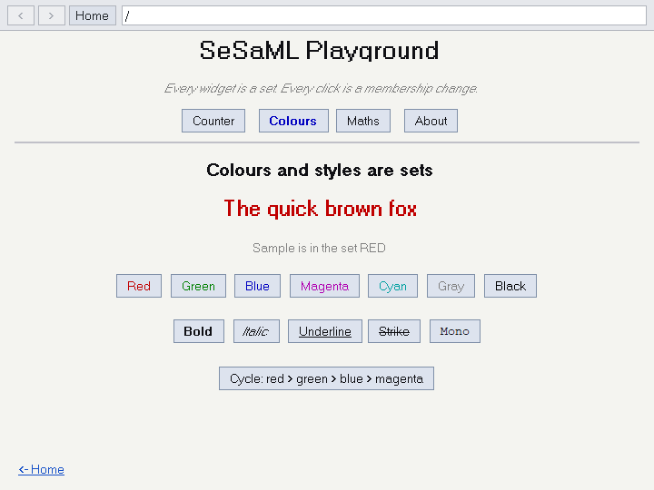

# Naive

**Everything is a set. Membership is the only state.**

Naive is a small document language and viewer built on one idea: a web page is
a collection of sets. A button is a set. A colour is a set. A tab is a set of
widgets. Showing something is `ADD x TO VISIBLE`; painting it red is
`ADD x TO RED`; ticking a box is a membership change. There is no DOM, no CSS
and no JavaScript, only sets and the verbs that move things between them.

The viewer is a native Windows program written in portable C99, with a mock
"internet" (a folder of `.nve` pages you browse by route or by `domain.com`).



## A taste

```nve
CREATE Greeting AS TextBox
    WITH text = "Hello, World -- there is no DOM here, only sets."
    AT X.Center, Y.Center

CREATE HideButton AS Button
    WITH label = "Hide Greeting"
    AT X.Center, Y.300
    ON CLICK REMOVE Greeting FROM VISIBLE

-- a counter, with logic in a FUNCTION set (Lua-style bodies)
CREATE Tally AS SET

CREATE CountShow AS H1
    WITH text = "0"
    AT X.Center, Y.250

CREATE bump AS FUNCTION
    TAKES by
    SET Tally TO Tally.value + by.value
    SET CountShow TO Tally.value
END

CREATE Plus AS Button
    WITH label = "+1"
    AT X.Center, Y.350
    ON CLICK bump(1)
```

## Build and run

Windows with MinGW (`gcc`) and a POSIX `sh` (Git Bash works):

```sh
sh build/build.sh viewer                    # builds build/naive.exe
build/naive.exe examples/demo.nve       # open a page directly
build/naive.exe                         # or start at the mock site's home (www/)
```

On any other OS you can still check that the portable core compiles clean:

```sh
sh build/build.sh check                  # ISO C99, -pedantic-errors -Werror
```

Only `src/sm_win32.c` (the GDI backend) touches the platform. Everything else,
including the parser, set engine, expression evaluator and function
interpreter, is portable C99 behind the thin `SmCanvas` / `SmApp` interface in
`src/sm_render.h`, so another backend means reimplementing that one file.

## Learn it

The quick coding guide is [`docs/guide.md`](docs/guide.md). The design thinking behind
the language is in [`naive_design_doc.md`](naive_design_doc.md).

## Examples

Open them from the home page (`/examples`) or directly from `examples/`:

| File | What it shows |
|---|---|
| `demo.nve` | The playground: tabs, a counter, colour and style sets, recursive and iterative maths |
| `functions.nve` | User-defined `FUNCTION` sets and event bindings |
| `showcase.nve` | Every HTML-parity element: headings, lists, tables, forms, images, links |
| `form.nve` | Form inputs gathered as a set and submitted |
| `grid_demo.nve` | `DEFINE GRID`: a virtual coordinate system that scales with the window |
| `hello.nve` | The smallest page |

## The language in a minute

- **Everything is `CREATE name AS Type`**, followed by `WITH` properties, `AT X.n, Y.n`
  placement and `MEMBER OF` memberships. `AS Button, Blue` is shorthand for
  `MEMBER OF Blue`.
- **State is membership.** `ADD a TO b`, `REMOVE a FROM b`, `MOVE a FROM b TO c`,
  `SWAP`, `SET`. Visibility is membership in `VISIBLE`; colours (`RED`, `BLUE`, ...,
  all in `COLORS`) and font styles (`BOLD`, `ITALICS`, ...) are sets too.
- **Events** are `ON CLICK`, `ON CHANGE`, `ON TYPE`, `ON LOAD`, ... attached to a
  widget, with optional `WHERE` guards.
- **Formulas.** Any widget whose `content` starts with `=` is a live formula; its
  dependencies become members, so editing a cell recomputes everything downstream
  with no handler written. `SUM`, `AVG`, `MIN`, `MAX`, `COUNT` work over the members
  of a set.
- **Functions** are `FUNCTION` sets with Lua-style bodies: `IF/ELSEIF/ELSE/END`,
  `WHILE ... DO ... END`, `LOCAL`, `RETURN`, recursion, `..` concatenation and
  `== ~=` comparisons. `CREATE f AS FUNCTION, OnClick, Button_1` binds a function
  to an event.
- **`FOCUS`** is a built-in set holding the widget that has keyboard focus, so a page
  can react to selection (`ON CHANGE OF FOCUS WHERE Field IS FOCUS`).
- **Layout** is `X.Left/Center/Right/n`, `Y.Top/Center/n`, optional `width`,
  `height`, `align` and `bgcolor` properties, and `DEFINE GRID X 800, Y 1400` for a
  window-scaling virtual canvas.

The full thinking, including the parts not built yet, is in
[`naive_design_doc.md`](naive_design_doc.md) and
[`naive_grammar_sketch.md`](naive_grammar_sketch.md).

## Repository layout

```
src/        the engine, parser, interpreter, mock server and Win32 backend
examples/   standalone example pages
www/        the mock internet the viewer browses (index.nve, docs, xyz.com/, ...)
build/      build.sh
docs/       the coding guide and images used by this README
```

## Status and limits

Naive is an experiment, not a product. Network transport is mocked, there is one
(Windows) backend, `SEND` is recorded but does nothing, and formulas see only
numbers, strings and sets. The language is deliberately small.

## License

[MIT](LICENSE).
